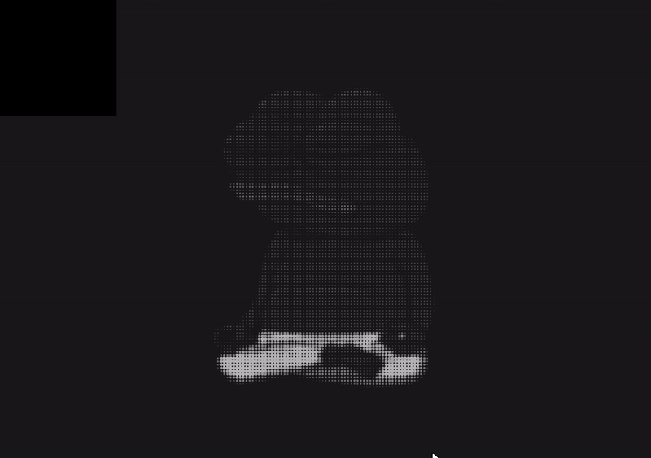
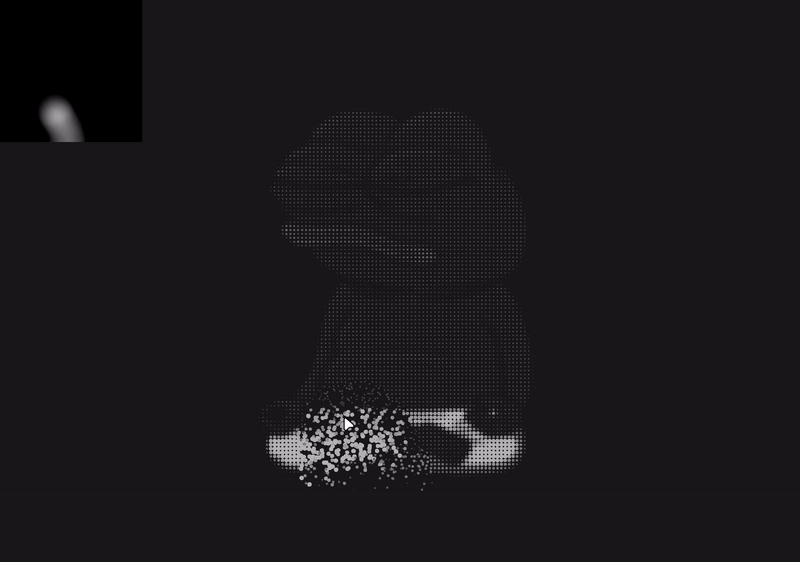
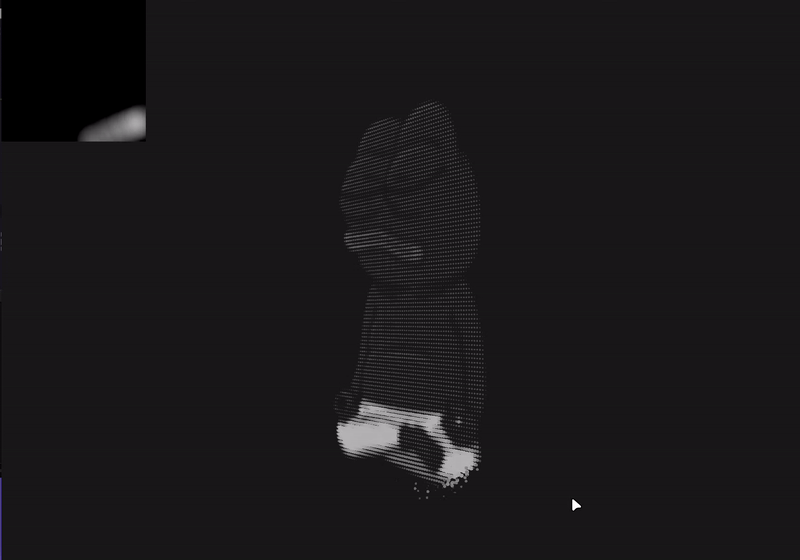

# Particles Cursor Animation

An interactive Three.js application that renders an image as particles.
Cursor movements create a fading trail that displaces the particles through a
shader. OrbitControls lets you rotate and zoom the view.







## Getting started

Requires Node.js and npm.

```bash
npm install
npm run dev
```

Open the local URL shown in the terminal in your browser.

## Production build

```bash
npm run build
```
